# mal-jml — Joiner / Leaver security automation

Python automation for the security-relevant steps of onboarding and offboarding across
Okta, Google Workspace, 1Password, Jamf and Slack. Every provider runs through the same
HTTP client in both live and mock mode, so mock runs exercise real request building,
error handling, retries and redaction — not a stub that returns `True`.

```
joiner:  Okta create + group ─▶ GWS create ─▶ 1Password invite + vault group ─▶ Jamf invite ─▶ alert
leaver:  Okta kill sessions + suspend ─▶ GWS revoke OAuth + sign out ─▶ 1Password strip groups + suspend ─▶ alert
                                         every run ─▶ logs/jml_audit.jsonl
```

## Real vs. mocked

| # | Capability | API used | Status |
|---|---|---|---|
| 1 | Okta create user, add to group, suspend/deactivate, clear sessions + OAuth tokens | Okta Users, Groups, Lifecycle, Sessions API | **Real** — runs live when `OKTA_*` set |
| 2 | GWS create user, revoke all OAuth tokens, sign out | Admin SDK Directory API (`users`, `users.tokens`, `users.signOut`) | **Real** — runs live when `GWS_*` set |
| 3 | 1Password vault-group assignment / removal, suspend | 1Password **SCIM Bridge** (SCIM 2.0) | **Real** — runs live when `OP_*` set |
| 4 | Jamf enrollment invitation | Jamf Pro OAuth client credentials + Classic API `computerinvitations` | **Mocked** — no free Jamf tenant; realistic XML payload and response fixture |
| 5 | Completion alert | Slack incoming webhook, SMTP fallback | **Real** — runs live when `SLACK_WEBHOOK_URL` / `SMTP_*` set |

`JML_MODE=auto` (default) picks live per provider when its credentials exist and mocks the
rest; the alert footer always names which systems were mocked, so a mock run can't be
mistaken for a real offboarding.

**Live verification log** — tick when run against a real tenant:

- [x] Okta Developer org — joiner and leaver run live on 2026-10-31 (see Evidence)
- [ ] Google Workspace trial
- [ ] 1Password Business trial + SCIM Bridge
- [ ] Slack webhook

### Why SCIM for 1Password, not Connect or Events

The brief suggests the Connect or Events API. Neither can change vault access: **Connect**
reads and writes vault *items* only, and **Events** is a read-only audit feed. In 1Password
Business, vault permissions are granted to groups, and group membership plus user
suspension are what the SCIM Bridge exposes — so that is what this uses. Suspension is the
backstop for any vault shared directly with the user rather than via a group. The Events
API is the right tool for *verifying* offboarding afterwards (see "Not done").

## Setup

```bash
python -m venv .venv && source .venv/bin/activate
pip install -r requirements-dev.txt
cp .env.example .env        # fill in whatever tenants you have; leave the rest blank
```

All secrets come from environment variables (or `.env`, which is git-ignored). Nothing is
hardcoded; tokens, passwords and client secrets are redacted before anything is logged.

**Okta** — create a free Okta Developer (Integrator) org, create group `engineering`, then
Security → API → Tokens. Prefer a token from a dedicated admin with Group Admin rights over
a Super Admin token.

**Google Workspace** — in a Business trial: create a GCP service account, enable the Admin
SDK API, grant domain-wide delegation (Admin console → Security → API controls) for
`admin.directory.user` and `admin.directory.user.security`, and set `GWS_ADMIN_SUBJECT` to
an admin the service account impersonates.

**1Password** — Business trial → Integrations → Automated User Provisioning → deploy the
SCIM Bridge, create group `Engineering` and grant it the relevant vaults.

**Slack** — create an app with an incoming webhook to your security channel.

## Run

```bash
python -m jml joiner --first Aisha --last Khan --email aisha.khan@mal.example \
    --okta-group engineering --vault-group Engineering

python -m jml leaver --email omar.haddad@mal.example            # suspend (reversible)
python -m jml leaver --email omar.haddad@mal.example --deactivate

JML_MODE=mock python -m jml leaver --email omar.haddad@mal.example   # force all-mock
```

Exit code is `0` when every step succeeded, `1` when any step failed (so a scheduler can
page), `2` on configuration error. The full run report is printed as JSON and appended to
`JML_AUDIT_LOG`.

Sample alert (mock run):

```
JML leaver — omar.haddad@mal.example
Run ID: 49db5b1de1da
Started: 2026-10-31T06:33:44+00:00  Finished: 2026-10-31T06:33:44+00:00
Result: OK

[OK ] okta: clear sessions + suspend
[OK ] gws: revoke OAuth tokens
[OK ] gws: sign out all sessions
[OK ] 1password: remove from groups + suspend
```

## Behaviour worth knowing

- **Failure isolation.** Each step is wrapped independently. If Okta is down, GWS tokens
  and 1Password are still revoked, and the alert lists exactly what failed.
- **Leaver ordering.** Okta sessions and Okta-issued OAuth tokens are cleared explicitly
  before suspension rather than relying on lifecycle side effects; GWS `signOut` follows token revocation
  because revoking OAuth grants does not end browser sessions.
- **Idempotent joiner.** Re-running against an existing Okta login (`E0000001`), GWS user
  (409) or 1Password user returns the existing account instead of failing.
- **Rate limits.** 429/5xx are retried with `Retry-After` or Okta's `X-Rate-Limit-Reset`.
- **GWS password.** A random 32-char password is generated, never logged or returned, with
  `changePasswordAtNextLogin` set; normal sign-in is via Okta SSO.
- **Protected 1Password groups** (`Owners`, `Recovery`) are not auto-removed — flagged for
  manual review instead.

## Tests and lint

```bash
pytest -q          # 33 tests: HTTP-level tests per client (responses) + end-to-end mock runs
ruff check .
black --check .
```

CI (`.github/workflows/ci.yml`) runs all three on every push.

## Not done (deliberately)

- No GWS suspension or Drive/Calendar data transfer — needs a manager-handover decision first.
- No Jamf device lock/wipe on leaver; no MDM check that the joiner actually enrolled.
- No post-run verification (re-reading Okta status, 1Password Events API sign-in attempts).
- No HRIS trigger — invoked from CLI; production would be an HRIS webhook or Okta Workflows.
- No "mover" flow (role change = group diff); the joiner/leaver primitives cover it.

## Evidence (live Okta run, 2026-10-31)

Okta ran **live** against an Okta Integrator org; Google Workspace, 1Password and Jamf ran in **mock** mode.
Personal and ex-employer details and IP addresses are cropped or masked.

**Joiner: Aisha Khan created and added to `engineering`**

| Before | Script output | After |
|---|---|---|
| 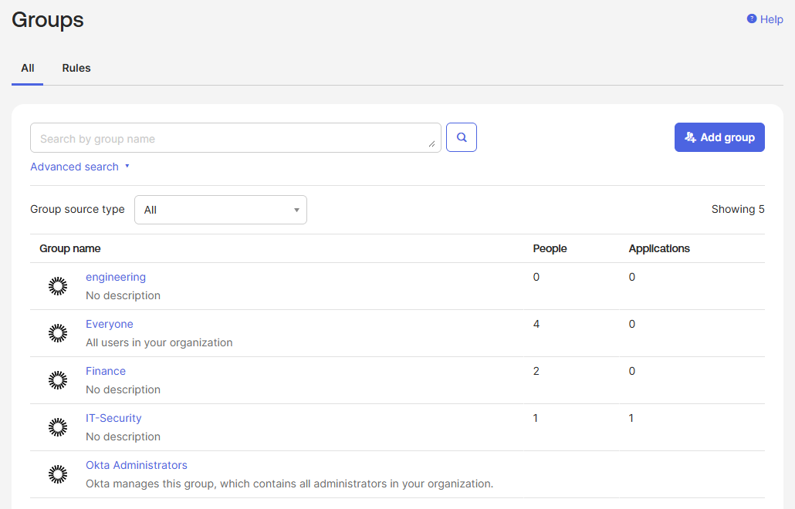 | 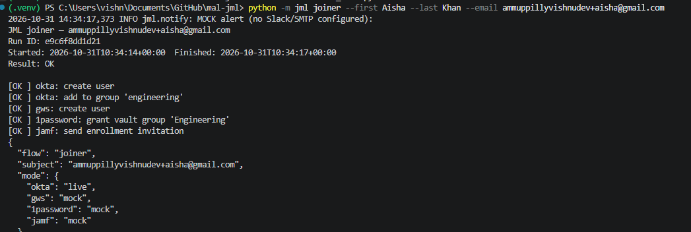 | 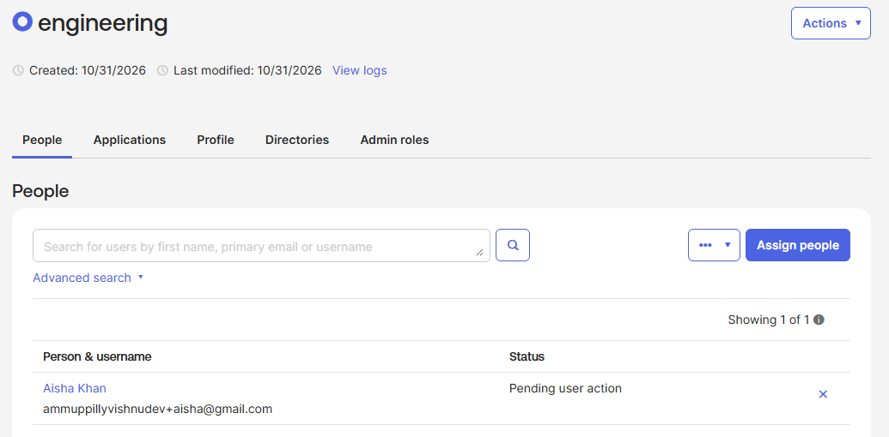 |

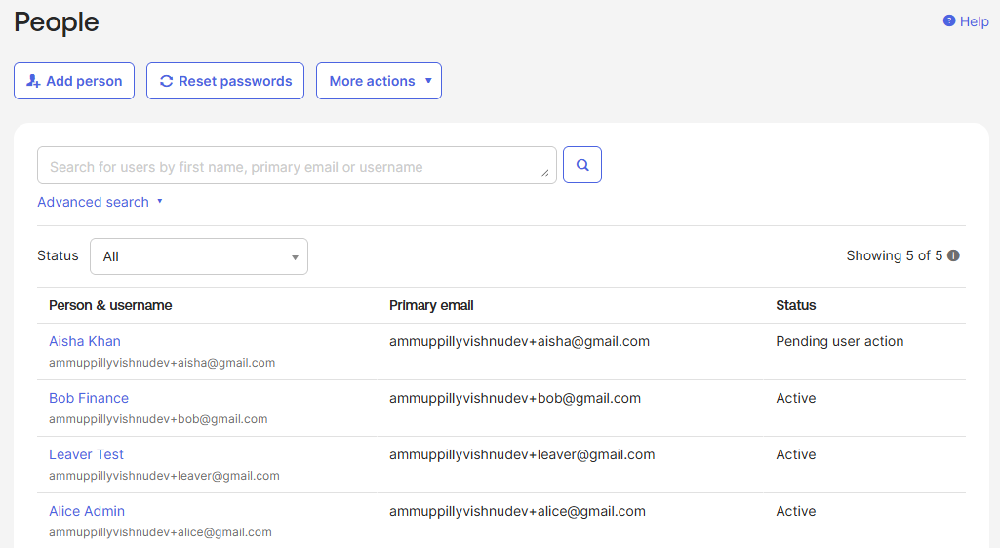

Aisha shows **Pending user action**: Okta has emailed her activation link and she becomes Active once she sets a password.

**Leaver: Leaver Test offboarded**

| Before (Active) | After (Suspended) |
|---|---|
| 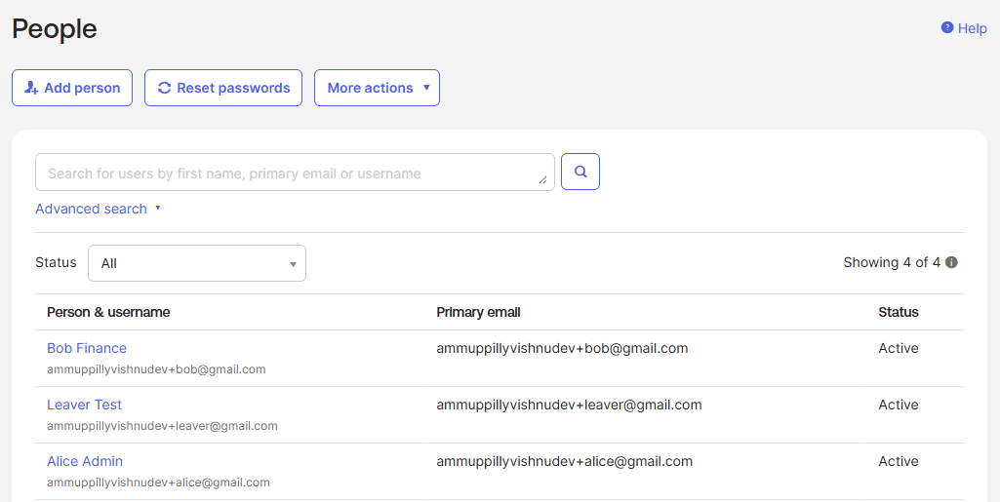 | 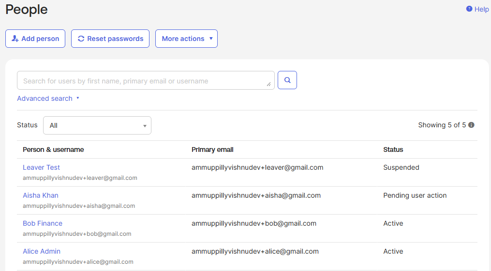 |

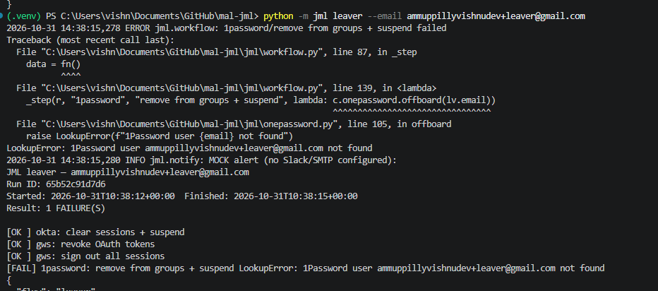

The Okta steps succeeded live. The 1Password step failed because 1Password is mocked and its fixture only
knows the sample user `omar.haddad@mal.example`; the failure is reported and does not stop the other steps.

**Okta System Log: the audit trail**

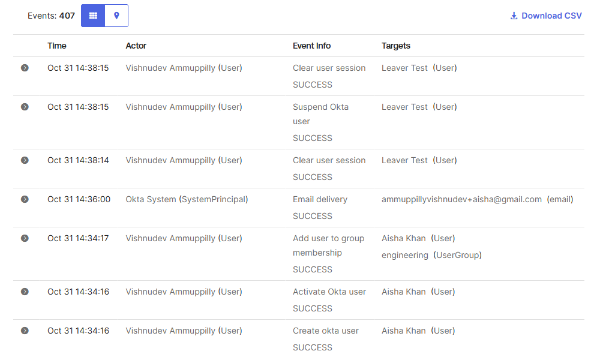

Read bottom to top: create user, activate, add to group (joiner); then clear sessions, suspend (leaver).
Okta clears sessions again itself as part of suspending.

**Failure handling**

| Mock run: unknown user in 1Password | Live run: invalid Okta token (HTTP 401) |
|---|---|
| 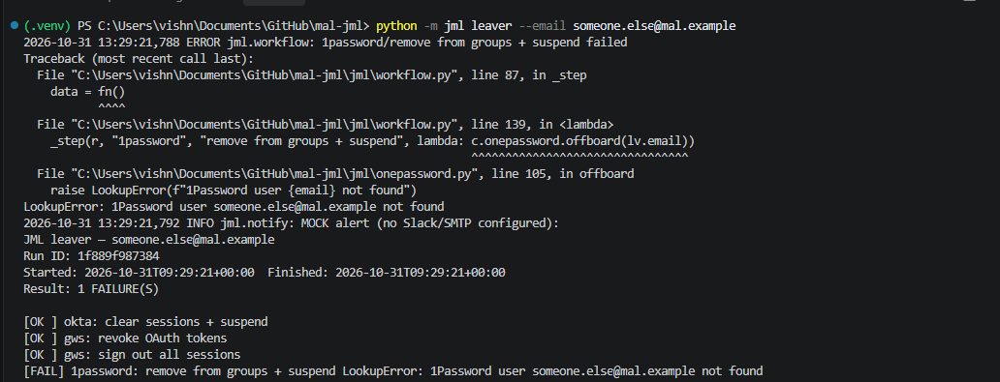 | 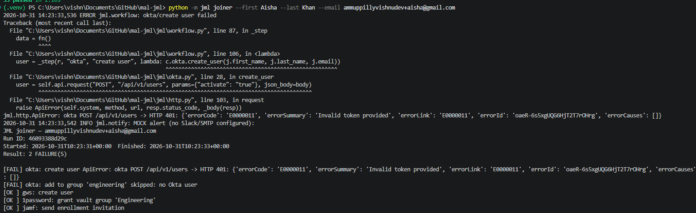 |

The 401 came from an early misconfiguration (the template's placeholder org URL). It was not retried, the
dependent group step was skipped, and the run reported 2 failures. That led to the template fix and a startup check.

**Tests and lint**

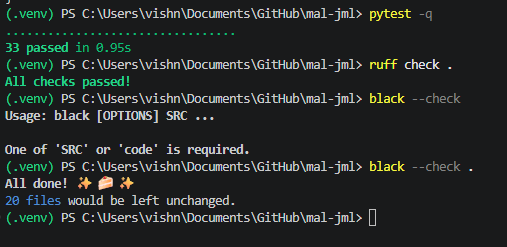

## Part 2

Architecture and trade-offs write-up: [`docs/Mal_Endpoint_Identity_Architecture.pdf`](docs/Mal_Endpoint_Identity_Architecture.pdf)

## Layout

```
jml/
  http.py         ApiClient (auth, retry, errors) + fixture-backed MockSession
  okta.py         Okta users, groups, lifecycle, sessions
  gws.py          Admin SDK users, tokens, signOut; service-account auth
  onepassword.py  SCIM Bridge users, groups, suspension
  mdm.py          Jamf OAuth + enrollment invitation
  notify.py       Slack Block Kit alert, SMTP fallback
  workflow.py     joiner/leaver orchestration, step isolation
  audit.py        JSONL audit trail
  fixtures/       realistic API responses for mock mode
tests/
```
